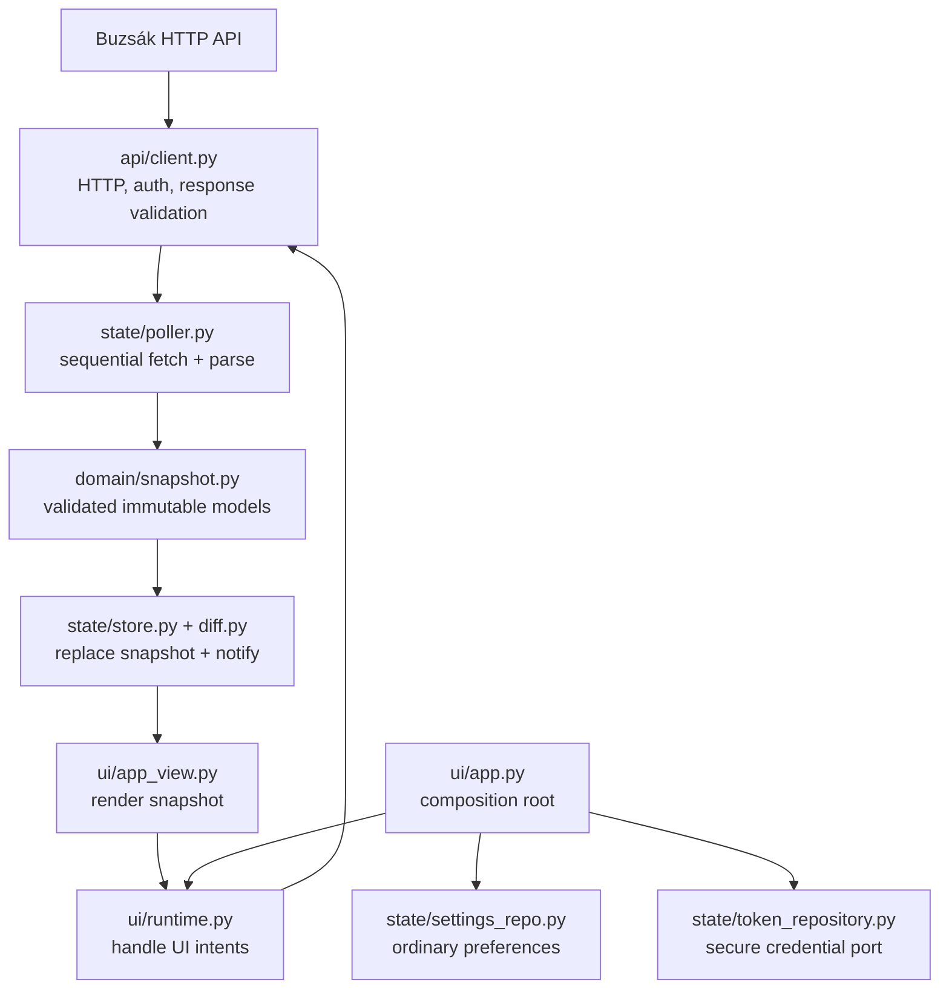
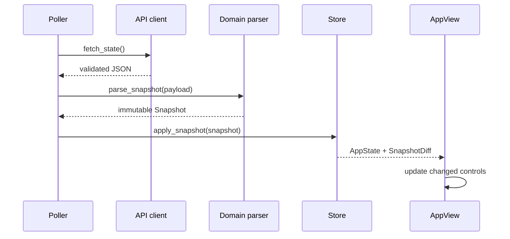

# Architecture

Covers ARC-04..ARC-10, ARC-06, SRV-10, DOC-02.

## Module boundaries

`ui/app.py` is the composition root: it attaches Flet services, loads settings, selects fake/live session configuration, constructs `Runtime`, and starts it. `Runtime` owns the API client, poller, store and `AppView`; it also coordinates command and pulse lifecycles and restarts the connection when settings change. `AppView` is presentation-only: it builds tabs, subscribes to store updates, applies diffs and forwards user intents through callbacks.

`api/` is the only package that performs HTTP (`SRV-10`). It returns validated JSON objects and typed transport errors; `domain/` parses snapshots into frozen dataclasses and represents value quality explicitly. `state/` owns the immutable application snapshot, diffs, serialized polling, ordinary settings persistence and the secure-token repository protocol. `ui/runtime.py` is the UI-layer orchestrator for commands because its workflows are initiated and rendered by controls; it never mutates reported physical state optimistically.

## Android Integration Boundary

Verified structure (ARC-01, ARC-04, SRV-10; ADR-0009/0010): native Android implementation is confined to the independent Flutter plugin in `native/buzsak_monitor/`. Its Gradle configuration, manifest, Java sources and native tests stay together. It is a build dependency, not a second application or a business-logic layer.

The Python boundary is [NotificationBridge](../src/buzsak_app/state/alert_session.py), a platform-neutral protocol used by `AlertSession` and injected into `Runtime`. Its entire contract is `start() -> bool`, `stop() -> None`, `active() -> bool`, `status() -> str`, `permission_granted() -> bool`, and `notify(name: str) -> bool`. Callers do not receive Java objects, Android contexts, intents, notification IDs or storage handles. Tests substitute a fake bridge without loading Java or Pyjnius.

[AndroidNotifications](../src/buzsak_app/ui/android_notifications.py) is the sole Python adapter permitted to load Pyjnius or reference native class names. It loads the plugin lazily, translates Python calls to the Java facade and obtains user-visible labels from the central strings module. The adapter stays in the outer UI layer, preserving the existing downward-import rules; `domain/` and `state/` remain independent of Android and Flet.

Within the native plugin, `MonitorPlugin` is the callable facade, `MonitorService` owns the bounded Android foreground-service lifecycle, `PendingAlerts` owns durable occurrence storage/notification construction, and `AlertReceiver` handles OS reboot and explicit acknowledgment broadcasts. The native side receives labels and fired alert names, never server URLs, bearer tokens, telemetry snapshots, rule expressions or Python evaluator state. HTTP, authentication, telemetry validation, condition evaluation, rearming and cooldowns remain Python responsibilities.

`tests/test_architecture.py` checks for Pyjnius imports/native class references outside the adapter, Java/Kotlin sources outside the plugin in the application source trees, and common networking-library imports in native production Java. These are dependency guardrails, not a sandbox or proof that arbitrary future code cannot perform networking. Device/background acceptance remains separate from structural isolation.

## Data and command flows

Controls dispatch intents to `Runtime`. Idempotent valve commands use the server command API and its status endpoint; the garage pulse is a single non-idempotent POST, then GET-only snapshot observation. `Runtime` never retransmits a pulse. In both cases, server-reported snapshots/status remain authoritative.

## Security and settings

URL, poll interval and timeouts use Flet `SharedPreferences`; the serialized `Settings` intentionally excludes the token. After an authenticated state snapshot validates, the token is stored through `SecureTokenRepository` backed by Flet Secure Storage / Android Keystore (ADR-0006). Sign out removes it. Fake/live launcher credentials are session-only. Server-side expiry and revocation remain authoritative.

## Guardrails and tests

`tests/test_architecture.py` enforces downward package imports, keeps Flet out of `api/`, `domain/` and `state/`, ensures HTTP client imports remain within `api/`, and checks that the composition root, view and Runtime stay in separate modules. Behavior and lifecycle contracts are tested in the domain, state, API, UI and loopback fake-server suites. The fake server binds to loopback and never contacts real devices.
